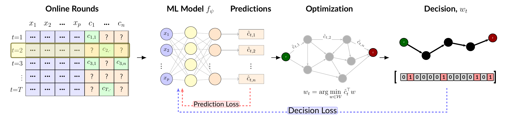

# BayesianSPO

Decision-focused learning for online combinatorial semi-bandits.

BayesianSPO decouples two jobs that become tangled under semi-bandit feedback:
Bayesian last-layer inference supplies UCB exploration and missing-cost
imputations, while masked SPO+ updates train the shared representation only on
observed components.



## Setup

```bash
uv venv
source .venv/bin/activate
uv sync
```

The code uses Python `>=3.10`. Optimization-backed benchmarks use `gurobipy`;
activate a Gurobi license before running those experiments.

## Reproduce Paper Results

```bash
# Tune hyperparameters
bash tune_online.sh

# Run final online evaluations
bash run_online.sh

# Generate main paper figures from saved results
bash run.sh

# Run ablations
bash run_ablations.sh
```

Final paper artifacts are consolidated under `results/paper/`. Paper figures are
written to `paper_neurips_2026/result_figures/`.

## Common Commands

```bash
# Tune one benchmark
uv run python experiments/tune_hyperparams.py \
  --all --dataset knapsack_32 --feedback semi_bandit --n-rounds 1000 --analyze

# Evaluate one benchmark
uv run python experiments/evaluate_online.py \
  --datasets knapsack_32 --feedback semi_bandit --full \
  --output_dir results/eval_online

# Re-plot core results without rerunning experiments
uv run python experiments/plot_paper_core_results.py \
  --trajectories results/eval_online_10k/metrics/trajectories.pkl \
  --canonical-regrets results/eval_online_10k/metrics/final_eval_regrets.json \
  --canonical-times results/eval_online_10k/metrics/final_eval_summary.csv \
  --output paper_neurips_2026/result_figures
```

## Benchmarks

`knapsack_32`, `knapsack_100`, `shortest_path_8x8`,
`shortest_path_20x20`, and `portfolio_32`.

## Main Agents

| Agent | Role |
| --- | --- |
| `BayesianSPO` | Main method: Bayesian head, UCB action selection, masked SPO+ feature updates |
| `BayesianMSE` | Prediction-focused Bayesian baseline |
| `LinUCB` | Linear contextual semi-bandit baseline |
| `TS` | Thompson-sampling baseline |
| `NeuralUCB`, `WeberBLL`, `EpsilonGreedy`, `Random` | Additional baselines |

## Key Scripts

| Script | Purpose |
| --- | --- |
| `experiments/tune_hyperparams.py` | Optuna tuning |
| `experiments/evaluate_online.py` | Online evaluation |
| `experiments/plot_paper_core_results.py` | Main-result figures |
| `experiments/plot_ablation_results.py` | Ablation figures |
| `experiments/ablations/*.py` | Core design and sensitivity ablations |

## Structure

```text
src/
  agents/contextual/   # BayesianSPO and baselines
  envs/                # Semi-bandit environments
  solvers/             # Combinatorial optimizers
  losses.py            # SPO+ and prediction losses
experiments/
  ablations/           # Paper ablations
  rebuttal/            # Retained rebuttal experiments
    nonlinear/         # Nonlinear extension
results/paper/         # Submitted result archive, preserved unchanged
```

## PyEPO online extension

The [PyEPO fork](https://github.com/Aabhash/PyEPO) is a separate repository. Its online extension provides full-feedback and semi-bandit comparisons. Start with `notebooks/11 Online Learning.ipynb`.

## Citation

If you use this code, please cite our paper:

```bibtex
@inproceedings{dhakal2026semibandit,
  author = {Aabhash Dhakal and Tim Lachner and Jayanta Mandi and Marco Foschini and Christoph Michael Flath},
  title = {Online Decision-Focused Learning under Semi-Bandit Feedback},
  booktitle = {40th Annual Conference on Neural Information Processing Systems},
  year = {2026},
  url = {https://neurips.cc/virtual/2026/loc/sydney/poster/150539}
}
```

## License

This repository is released under the GNU General Public License v3.0 or later
(GPL-3.0-or-later). Redistributed copies and derivative works must preserve the
copyright notice and license terms; see `LICENSE`.
